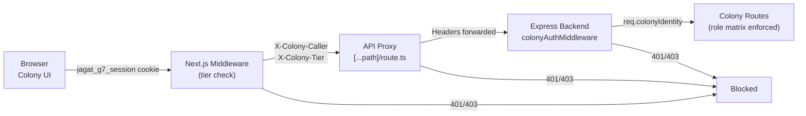

# JAGAT Colony — Gap Audit & Security Hardening Checklist

> **Phase C2.5 / C4.5 — Colony Governance & Security Hardening**
> Audit date: 2026-05-27
> Auditor: Antigravity (atas permintaan Founder)

---

## Status Dokumen

Dokumen ini adalah **snapshot audit awal sebelum hardening auth Colony diterapkan**.

Artinya:

- temuan GAP 1-10 di bawah ini adalah **baseline historical findings**
- dokumen ini **bukan lagi source of truth tunggal** untuk status implementasi terkini
- status implementasi terkini harus dicocokkan dengan:
  - `ops/COLONY_DRY_RUN_TRACE.md`
  - `ops/JAGAT_COLONY_PHASE3_COMMISSIONING_CHECKLIST.md`
  - `ops/DECISION_LOG.md`

> [!IMPORTANT]
> Gunakan dokumen ini untuk memahami **apa yang dulu salah** dan **kenapa hardening dilakukan**.
> Jangan gunakan dokumen ini sendirian untuk menyimpulkan bahwa semua gap masih terbuka di codebase saat ini.

### Ringkasan Status Terkini

| Area | Status Terkini |
| --- | --- |
| Founder-only secure baseline | Implemented secara kode, static verified |
| Runtime commissioning founder flow | Sudah punya trace/checklist, tetap perlu disiplin pembuktian runtime saat environment berubah |
| Multi-role matrix (`ULTRA`, `internal_ops`) | Structural only, belum aktif penuh |
| Source of truth operasional | `COLONY_DRY_RUN_TRACE.md` + `JAGAT_COLONY_PHASE3_COMMISSIONING_CHECKLIST.md` |

## Executive Summary

Colony framework sudah ada dan terstruktur cukup baik: types, task engine, mission engine, agent registry, chat engine, approval engine, routes, dan UI. **Tapi seluruh stack ini terbuka tanpa auth enforcement sama sekali** — baik di middleware Next.js, di API proxy, maupun di backend Express. Ini harus dikunci sebelum colony bisa dipakai secara internal.

> [!CAUTION]
> **Saat ini, siapa pun yang mengetahui URL `/api/colony/bootstrap` bisa meng-initialize colony, membuat mission, mengirim chat, dan menyetujui approval tanpa otentikasi apa pun.**

> [!NOTE]
> Paragraf di atas menggambarkan **kondisi pada saat audit awal tanggal 2026-05-27**, bukan otomatis kondisi codebase terkini.

---

## Audit Scope

| Layer | File | Status |
|-------|------|--------|
| Types & State Machine | [types.ts](file:///c:/JAGAT/src/colony/types.ts) | ✅ Solid |
| Task Engine | [task-engine.ts](file:///c:/JAGAT/src/colony/task-engine.ts) | ✅ Solid, validasi transisi ada |
| Mission Engine | [mission-engine.ts](file:///c:/JAGAT/src/colony/mission-engine.ts) | ⚠️ No auth check |
| Agent Registry | [agent-registry.ts](file:///c:/JAGAT/src/colony/agent-registry.ts) | ✅ Permission model ada tapi belum dipakai di routes |
| Approval Engine | [approval-engine.ts](file:///c:/JAGAT/src/colony/approval-engine.ts) | ⚠️ `respondedBy` diterima dari body tanpa validasi |
| Chat Engine | [chat-engine.ts](file:///c:/JAGAT/src/colony/chat-engine.ts) | ⚠️ `senderRole` diterima dari body tanpa validasi |
| Express Routes | [routes.ts](file:///c:/JAGAT/src/colony/routes.ts) | 🔴 **Tidak ada auth middleware** |
| Server Mount | [index.ts](file:///c:/JAGAT/src/index.ts#L91) | 🔴 `app.use("/colony", colonyRouter)` — no guard |
| Next.js Middleware | [middleware.ts](file:///c:/JAGAT/jagat-ui/src/middleware.ts#L3) | 🔴 `/colony` dan `/api/colony` = public path |
| API Proxy | [route.ts](file:///c:/JAGAT/jagat-ui/src/app/api/colony/%5B...path%5D/route.ts) | 🔴 Proxy tanpa auth forwarding |
| Colony UI | [page.tsx](file:///c:/JAGAT/jagat-ui/src/app/colony/page.tsx) | ⚠️ Client-side tier check saja |
| Token Client | [token-client.ts](file:///c:/JAGAT/jagat-ui/src/lib/token-client.ts) | ⚠️ Base64 cookie, bukan JWT/HMAC |
| Token Registry | [token-registry.ts](file:///c:/JAGAT/jagat-ui/src/lib/token-registry.ts) | ✅ Validation logic ada |

---

## 🔴 GAP 1 — Middleware Public Path (CRITICAL)

**File:** [middleware.ts](file:///c:/JAGAT/jagat-ui/src/middleware.ts#L3)

```typescript
const PUBLIC_PATHS = ["/login", "/pricing", "/about", "/g7-admin", "/colony", "/api/auth", "/api/admin", "/api/colony", "/_next", "/favicon.ico"];
```

### Problem
- `/colony` dan `/api/colony` di-list sebagai public path
- Middleware Next.js hanya cek keberadaan cookie `jagat_g7_session` — **tidak cek isi/tier cookie**
- Jadi **bahkan user tanpa cookie bisa akses** `/api/colony/*` endpoints

### Required Fix
1. **Hapus** `/colony` dan `/api/colony` dari `PUBLIC_PATHS`
2. Tambah **tier-aware middleware check**: baca cookie → decode → cek `tier === "SOVEREIGN"` → baru izinkan
3. Tambah daftar **SOVEREIGN_ONLY_PATHS** yang memerlukan clearance tertinggi

### Impact
| Tanpa fix | Risiko |
|-----------|--------|
| Siapa pun bisa panggil `/api/colony/bootstrap` | Colony bisa di-reset oleh publik |
| Siapa pun bisa panggil `/api/colony/tasks` | Informasi internal bocor |
| Siapa pun bisa POST ke `/api/colony/missions` | Mission palsu masuk |
| Siapa pun bisa PATCH approval | Approval palsu disetujui |

---

## 🔴 GAP 2 — API Proxy Tanpa Auth Forwarding (CRITICAL)

**File:** [route.ts](file:///c:/JAGAT/jagat-ui/src/app/api/colony/%5B...path%5D/route.ts)

### Problem
```typescript
// GET, POST, PATCH semua langsung proxy ke backend tanpa:
// 1. Membaca/memvalidasi session cookie
// 2. Mengirim auth header ke backend
// 3. Menambah caller identity ke request
```

### Required Fix
1. Baca `jagat_g7_session` cookie di proxy
2. Decode dan validasi: tier harus `SOVEREIGN`
3. Inject header `X-Colony-Caller` dan `X-Colony-Tier` ke request ke backend
4. Backend Express harus **memvalidasi header ini**

---

## 🔴 GAP 3 — Backend Colony Routes Tanpa Auth (CRITICAL)

**File:** [routes.ts](file:///c:/JAGAT/src/colony/routes.ts)

### Problem
- 19 endpoint, **nol auth middleware**
- Tidak ada pengecekan siapa yang memanggil
- Endpoint sensitif seperti `/bootstrap`, `POST /tasks`, `PATCH /approvals/:id` terbuka penuh

### Required Fix: Colony Auth Middleware

Buat middleware Express `colonyAuthGuard` yang:

```
1. Baca header X-Colony-Caller + X-Colony-Tier
   (atau langsung baca cookie jika direct call)
2. Tentukan HumanRole dari tier:
   SOVEREIGN → founder
   (future: ULTRA → executive_product/executive_infra)
3. Inject req.colonyIdentity = { role, name, tier }
4. Per-endpoint permission matrix:
```

| Endpoint | Method | Minimum Role |
|----------|--------|-------------|
| `/bootstrap` | POST | `founder` only |
| `/stats` | GET | `founder`, `executive_*` |
| `/tasks` | GET | `founder`, `executive_*`, `internal_ops` |
| `/tasks` | POST | `founder`, `executive_product` |
| `/tasks/:id/status` | PATCH | `founder`, `executive_*` |
| `/tasks/:id/evidence` | POST | `founder`, `executive_*` |
| `/missions` | GET | `founder`, `executive_*` |
| `/missions` | POST | `founder` only |
| `/missions/:id` | PATCH | `founder` only |
| `/agents` | GET | `founder`, `executive_*` |
| `/agents/:id/status` | PATCH | `founder` only |
| `/chat/rooms` | GET | `founder`, `executive_*`, `internal_ops` |
| `/chat/rooms` | POST | `founder` only |
| `/chat/rooms/:id/messages` | GET | `founder`, `executive_*`, `internal_ops` |
| `/chat/rooms/:id/messages` | POST | `founder`, `executive_*` |
| `/approvals` | GET | `founder` |
| `/approvals` | POST | `founder`, `executive_*` |
| `/approvals/:id` | PATCH | **`founder` only** (approval gate) |

---

## 🔴 GAP 4 — Hardcoded Founder Identity di UI (HIGH)

**File:** [page.tsx](file:///c:/JAGAT/jagat-ui/src/app/colony/page.tsx)

### Occurrences

| Line | Code | Problem |
|------|------|---------|
| [L265](file:///c:/JAGAT/jagat-ui/src/app/colony/page.tsx#L265) | `senderId: "founder"` | Hardcoded string, bukan dari session |
| [L266](file:///c:/JAGAT/jagat-ui/src/app/colony/page.tsx#L266) | `senderRole: "founder"` | Hardcoded, should derive from session tier |
| [L267](file:///c:/JAGAT/jagat-ui/src/app/colony/page.tsx#L267) | `senderName: "Faturachman Al Kahfi"` | Hardcoded name, should come from session `ownerName` |
| [L286](file:///c:/JAGAT/jagat-ui/src/app/colony/page.tsx#L286) | `createdBy: "founder"` | Mission creator tidak dari session |
| [L303](file:///c:/JAGAT/jagat-ui/src/app/colony/page.tsx#L303) | `respondedBy: "founder"` | Approval responder tidak dari session |
| [L304](file:///c:/JAGAT/jagat-ui/src/app/colony/page.tsx#L304) | `"Disetujui oleh founder"` | Hardcoded response note |
| [L403](file:///c:/JAGAT/jagat-ui/src/app/colony/page.tsx#L403) | `Faturachman AK` | Hardcoded sidebar badge |

### Required Fix
1. Baca `ownerName` dari `readSessionCookie()` — sudah bisa dilakukan
2. Derive `senderRole` / `createdBy` dari session tier, bukan hardcoded:
   ```
   SOVEREIGN → "founder"
   ULTRA → check executive assignment
   ```
3. Sidebar badge harus tampilkan `session.ownerName` dinamis
4. Semua request body harus menyertakan `callerToken` atau memakai cookie, **bukan string literal**

---

## ⚠️ GAP 5 — Client-Side Only Auth Check (MEDIUM)

**File:** [page.tsx](file:///c:/JAGAT/jagat-ui/src/app/colony/page.tsx#L178-L182)

```typescript
useEffect(() => {
  const s = readSessionCookie();
  setAuthorized(s?.tier === "SOVEREIGN");
  setChecked(true);
}, []);
```

### Problem
- Auth check hanya client-side (React state)
- Cookie `jagat_g7_session` = base64-encoded JSON — **trivially forgeable**
- User bisa buat cookie palsu `{ tier: "SOVEREIGN" }` dan bypass UI gate
- **API calls tetap lewat tanpa auth di proxy/backend**

### Required Fix
1. **Server-side validation** di Next.js middleware (GAP 1 fix)
2. **Cookie signing**: gunakan HMAC atau JWT agar tidak bisa dipalsukan
3. Pertimbangkan **server component** atau **getServerSideProps** untuk validasi sebelum render

---

## ⚠️ GAP 6 — Session Cookie Tanpa Signing (MEDIUM)

**File:** [token-client.ts](file:///c:/JAGAT/jagat-ui/src/lib/token-client.ts#L32-L36)

```typescript
export function bakeSessionCookie(payload: SessionPayload): void {
  const encoded = btoa(JSON.stringify(payload));  // plain base64, no signature
  document.cookie = `jagat_g7_session=${encoded}; path=/; max-age=${maxAge}; SameSite=Lax`;
}
```

### Problem
- Cookie hanya base64 — bisa di-decode dan dimodifikasi oleh siapa pun
- Tidak ada HMAC, JWT, atau mekanisme integrity check
- Ini membuat **semua client-side tier checks meaningless**

### Required Fix
1. **Server-side cookie setting** via API route yang menandatangani cookie dengan secret key
2. Atau gunakan **iron-session** / **jose** library untuk encrypted cookies
3. Backend validate signature saat menerima request

---

## ⚠️ GAP 7 — Approval Engine Tanpa Caller Verification (MEDIUM)

**File:** [approval-engine.ts](file:///c:/JAGAT/src/colony/approval-engine.ts#L51-L55)

```typescript
export async function respondToApproval(
  approvalId: string,
  response: "approved" | "rejected",
  respondedBy: string,    // accepted from request body as-is
  note?: string,
): Promise<ApprovalRequest> {
```

### Problem
- `respondedBy` datang dari request body — client bisa isi apa saja
- Tidak ada validasi bahwa caller benar-benar `founder`
- Ini critical karena approval adalah **governance gate**

### Required Fix
1. `respondedBy` harus di-derive dari auth middleware, bukan dari body
2. Validasi: hanya `HumanRole === "founder"` yang boleh respond
3. Log audit harus mencatat token/session yang digunakan

---

## ⚠️ GAP 8 — Agent Permission Model Tidak Dipakai di Routes (LOW-MEDIUM)

**Files:**
- [agent-registry.ts](file:///c:/JAGAT/src/colony/agent-registry.ts#L103-L121) — `checkPermission()` dan `enforcePermission()` sudah ada
- [routes.ts](file:///c:/JAGAT/src/colony/routes.ts) — tidak pernah memanggil fungsi ini

### Problem
- `DEFAULT_PERMISSIONS` dan `enforcePermission()` sudah didefinisikan
- Tapi **tidak ada route yang menggunakannya**
- Agent bisa melakukan apa saja tanpa boundary

### Required Fix
Ini akan menjadi penting di Phase C5. Untuk sekarang:
1. Dokumentasikan bahwa permission model sudah ada
2. Siapkan hook point di routes
3. Enforce di C5 saat agent mulai eksekusi otomatis

---

## ⚠️ GAP 9 — Chat `senderRole` Self-Declared (LOW)

**File:** [chat-engine.ts](file:///c:/JAGAT/src/colony/chat-engine.ts#L80-L90)

```typescript
export async function sendMessage(params: {
  roomId: string;
  senderId: string;
  senderRole: AgentRole | HumanRole;  // self-declared from body
  senderName: string;                 // self-declared
  content: string;
  ...
```

### Problem
- Siapa pun bisa klaim sebagai `founder` atau agent role apa pun
- Ini memungkinkan impersonation di internal chat

### Required Fix
- Derive identity dari auth context di middleware layer
- Chat messages harus menyimpan **verified sender identity**

---

## ⚠️ GAP 10 — Backend Express Tanpa CORS Restriction untuk Colony (LOW)

**File:** [index.ts](file:///c:/JAGAT/src/index.ts#L61)

```typescript
app.use(cors());  // allows all origins
```

### Problem
- CORS terbuka untuk semua origin
- Colony endpoints bisa dipanggil dari domain/origin mana pun

### Required Fix
- Restrict CORS origin untuk colony routes ke `localhost` / internal domain saja
- Atau lebih baik: colony routes hanya menerima internal calls (via proxy)

---

## Execution Checklist — Priority Order

### 🔴 Phase 1: Security Lock (Must-do before any colony usage)

- [ ] **1.1** — Hapus `/colony` dan `/api/colony` dari `PUBLIC_PATHS` di middleware.ts
- [ ] **1.2** — Tambah sovereign tier check di Next.js middleware untuk `/colony` dan `/api/colony/*`
- [ ] **1.3** — Tambah auth validation di API proxy route (`[...path]/route.ts`)
  - Baca cookie, decode, validate tier
  - Inject `X-Colony-Caller` dan `X-Colony-Tier` header
  - Return 401/403 jika tidak valid
- [ ] **1.4** — Buat `colonyAuthMiddleware` di Express backend (`src/colony/auth.ts`)
  - Validasi header dari proxy
  - Inject `req.colonyIdentity` ke request
  - Map tier → HumanRole
- [ ] **1.5** — Terapkan `colonyAuthMiddleware` ke semua colony routes
  - Per-endpoint role matrix sesuai tabel di GAP 3
- [ ] **1.6** — Replace hardcoded founder strings di `page.tsx`
  - Gunakan session data untuk `senderId`, `senderName`, `createdBy`, `respondedBy`
  - Sidebar badge dinamis dari session

### ⚠️ Phase 2: Identity Hardening (Should-do)

- [ ] **2.1** — Implement cookie signing (HMAC/JWT/iron-session)
  - Server-side cookie creation via `/api/auth/session`
  - Validation di middleware dan proxy
- [ ] **2.2** — Approval engine: derive `respondedBy` dari auth context, bukan body
- [ ] **2.3** — Chat engine: derive sender identity dari auth context
- [ ] **2.4** — Add audit logging: setiap colony action log timestamp + verified identity

### 📋 Phase 3: Dry Run Commissioning

- [ ] **3.1** — Bootstrap colony dengan auth aktif
- [ ] **3.2** — Create 1 test mission
- [ ] **3.3** — Create 3-5 tasks under mission
- [ ] **3.4** — Walk through full flow:
  - Create mission → assign task → update status → review → approval → done
- [ ] **3.5** — Test rejection flow:
  - Unauthorized user → harus dapat 401/403
  - Wrong tier → harus ditolak
  - Invalid transition → harus ditolak

### 🔮 Phase 4: Ready for C5

- [ ] **4.1** — Enforce agent permission model di routes
- [ ] **4.2** — Implement C5A: simulated workers (status update, report generation)
- [ ] **4.3** — Implement C5B: controlled execution with approval gates

---

## Architecture Decision: Auth Flow



---

## Files to Create/Modify

| Action | File | Description |
|--------|------|-------------|
| **MODIFY** | [middleware.ts](file:///c:/JAGAT/jagat-ui/src/middleware.ts) | Remove colony from public paths, add tier check |
| **MODIFY** | [route.ts](file:///c:/JAGAT/jagat-ui/src/app/api/colony/%5B...path%5D/route.ts) | Add auth validation + header forwarding |
| **NEW** | `src/colony/auth.ts` | Colony auth middleware for Express |
| **MODIFY** | [routes.ts](file:///c:/JAGAT/src/colony/routes.ts) | Apply auth middleware per-endpoint |
| **MODIFY** | [page.tsx](file:///c:/JAGAT/jagat-ui/src/app/colony/page.tsx) | Replace hardcoded identity with session data |
| **MODIFY** | [token-client.ts](file:///c:/JAGAT/jagat-ui/src/lib/token-client.ts) | Cookie signing (Phase 2) |

---

## Risk Assessment

| Risk | Severity | Current Status | After Fix |
|------|----------|---------------|-----------|
| Unauthorized colony access | 🔴 Critical | Open | Locked |
| Identity spoofing (cookie forgery) | 🔴 Critical | Trivial | Mitigated (Phase 2) |
| Approval without real auth | 🔴 Critical | Open | Founder-only gated |
| Agent impersonation in chat | ⚠️ Medium | Possible | Prevented |
| CORS exploitation | ⚠️ Low | Possible | Restricted |

---

> **Rekomendasi**: Eksekusi Phase 1 sekarang. Phase 2 bisa paralel atau segera setelah. Jangan lanjut ke C5 sebelum Phase 1 + 3 selesai.
