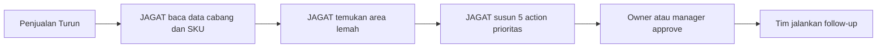
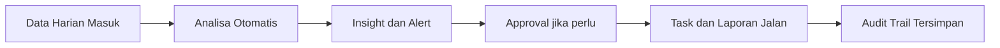

# JAGAT LinkedIn Use Case Canvas

Tanggal: 2026-06-20
Owner: Faturachman Al Kahfi
Tujuan: visual source untuk carousel LinkedIn, Canva, Figma, atau desain statis
Status: draft operasional

---

## 1. Arah Narasi

Jangan mulai dari:

- "super intelligence"
- "multi-agent"
- "sovereign architecture"
- "AI bisa segalanya"

Mulai dari:

- data perusahaan tersebar;
- laporan terlambat;
- owner atau manajemen telat ambil keputusan;
- proses berulang menyita waktu tim;
- JAGAT mengubah data menjadi insight lalu insight menjadi action.

One-liner paling aman:

> JAGAT membantu perusahaan membaca data internal, memberi insight untuk manajemen, lalu menjalankan proses berulang yang aman dan terukur.

---

## 2. Visual Utama yang Perlu Diposting

### Visual A - "Dari Data ke Action"

Tujuan:
Menjelaskan bahwa JAGAT bukan chatbot, tetapi mesin alur kerja untuk insight dan output.

Teks visual:

```text
DATA INTERNAL
Penjualan | Stok | Piutang | Produksi | SOP | Laporan Cabang

        ↓

JAGAT DATA GATEWAY
Upload Excel | Folder Share | API | Database Read-only

        ↓

JAGAT INTELLIGENCE LAYER
Cleaning | Mapping | Memory | Analisa | Risk Signal

        ↓

MANAGEMENT OUTPUT
Ringkasan Harian | Alert | Insight | Prioritas Tindakan

        ↓

CONTROLLED AUTOMATION
Task | Follow-up | Approval | Report | Reminder
```

Versi headline:

> Bukan AI yang hanya menjawab.  
> JAGAT mengubah data internal menjadi keputusan dan tindakan.

---

### Visual B - "Masalah Lama vs Cara Kerja Baru"

Tujuan:
Membantu orang bisnis langsung merasa, "ini masalah saya."

Kolom kiri:

```text
SEBELUM JAGAT
- Data tersebar di Excel, WA, PDF, ERP
- Laporan datang terlambat
- Owner menunggu admin rekap
- Masalah terlihat setelah terlambat
- Tugas berulang menghabiskan energi tim
```

Kolom kanan:

```text
SETELAH JAGAT
- Data masuk ke satu jalur baca
- Laporan otomatis lebih cepat
- Management dapat insight harian
- Risiko muncul lebih awal
- Proses berulang dijalankan dengan approval
```

Versi headline:

> Dari rekap manual dan telat tahu masalah  
> menjadi insight harian dan action yang lebih cepat.

---

### Visual C - "1 Hari Kerja Bersama JAGAT"

Tujuan:
Membumikan JAGAT ke aktivitas harian.

Isi visual:

```text
07:00
Data penjualan dan stok masuk

08:00
JAGAT kirim executive summary

09:00
JAGAT tandai cabang, SKU, atau distributor yang bermasalah

10:00
JAGAT buat rekomendasi action

11:00
Management approve tindakan

12:00+
Task, follow-up, dan laporan berjalan
```

Versi headline:

> Pagi hari mulai dengan insight.  
> Bukan mulai dengan cari-cari file.

---

## 3. Mermaid Source

### Diagram 1 - Data ke Action

```mermaid
flowchart TD
    A[Data Internal Perusahaan<br/>Sales | Stock | AR | Produksi | SOP] --> B[JAGAT Data Gateway<br/>Upload | Folder | API | Read-only DB]
    B --> C[JAGAT Intelligence Layer<br/>Cleaning | Mapping | Memory | Analysis]
    C --> D[Management Insight<br/>Summary | Alert | Priority | Recommendation]
    D --> E[Controlled Automation<br/>Task | Reminder | Follow-up | Approval | Report]
```

### Diagram 2 - Use Case Manajemen



### Diagram 3 - Proses Berulang



---

## 4. Carousel LinkedIn 5 Slide

### Slide 1

Headline:

> Banyak perusahaan sudah punya data.  
> Tapi belum punya sistem yang mengubah data menjadi action.

Support:

> Penjualan, stok, piutang, laporan cabang, dan SOP sering tersebar di banyak tempat.  
> Akibatnya, keputusan datang terlambat.

Visual:

- latar terang
- 5 blok data terpisah
- panah menuju satu pusat bertuliskan JAGAT

### Slide 2

Headline:

> JAGAT masuk lewat jalur data yang resmi.

Support:

> Upload Excel, folder sharing, API, atau database read-only.  
> Bukan menebak data. Bukan mengarang angka.

Visual:

- 4 pintu masuk
- masing-masing ikon diberi label:
- Excel
- Shared Folder
- API
- Read-only DB

### Slide 3

Headline:

> JAGAT membaca, merangkum, menandai risiko, lalu memberi rekomendasi action.

Support:

> Management tidak perlu menunggu rekap manual untuk tahu apa yang terjadi.

Visual:

- layer tengah dengan 4 modul:
- clean
- map
- analyze
- recommend

### Slide 4

Headline:

> Output yang dicari bisnis bukan jawaban panjang.  
> Output yang dicari bisnis adalah tindakan yang jelas.

Support:

> Daily summary, stock alert, cabang bermasalah, prioritas follow-up, dan laporan mingguan.

Visual:

- 5 kartu output
- summary
- alert
- action
- task
- report

### Slide 5

Headline:

> JAGAT bukan AI yang hanya menjawab.  
> JAGAT adalah sistem untuk insight, action, dan proses berulang yang lebih rapi.

Support:

> Cocok untuk pilot operasional, sales, distribusi, manufaktur ringan, dan command center internal.

CTA:

> Jika perusahaan Anda masih tenggelam dalam Excel dan laporan manual, mungkin sudah waktunya memakai alur kerja baru.

---

## 5. Use Case yang Paling Mudah Dijual

### Use Case 1 - Sales Command Center

Input:

- sales harian
- target
- cabang
- SKU
- distributor

Output:

- omzet harian
- target vs realisasi
- SKU paling lemah
- cabang turun
- 5 prioritas action

### Use Case 2 - Stock and Risk Monitor

Input:

- stok gudang
- pergerakan barang
- reorder point
- lead time

Output:

- stok kritis
- slow moving
- fast moving
- rekomendasi reorder
- warning risiko kehabisan

### Use Case 3 - Piutang and Follow-up Desk

Input:

- invoice
- tanggal jatuh tempo
- customer
- nominal

Output:

- daftar overdue
- prioritas follow-up
- reminder list
- laporan aging sederhana

---

## 6. Caption LinkedIn Draft

Versi singkat:

> Banyak perusahaan merasa mereka butuh AI.  
> Padahal yang lebih tepat: mereka butuh sistem yang bisa membaca data internal, memberi insight untuk manajemen, lalu membantu proses berulang berjalan lebih rapi.
>
> JAGAT kami bayangkan seperti itu.
>
> Bukan sekadar chatbot.  
> Bukan sekadar dashboard pasif.
>
> Tapi jalur kerja dari data -> insight -> action.
>
> Data bisa masuk lewat Excel, folder sharing, API, atau database read-only.  
> Output yang dicari bukan jawaban panjang, tapi ringkasan harian, alert, prioritas tindakan, dan automation yang aman.
>
> Ini salah satu gambaran use case yang sedang kami susun untuk JAGAT G7.

Versi lebih tajam:

> Masalah banyak bisnis bukan kekurangan data.  
> Masalahnya: data ada, tapi insight telat.  
> Insight ada, tapi action tidak jalan.
>
> JAGAT G7 kami arahkan untuk menutup gap itu:
>
> data internal -> analisa -> rekomendasi -> task -> laporan
>
> Kalau perusahaan masih tenggelam dalam Excel, PDF, grup chat, dan rekap manual, maka yang dibutuhkan bukan AI yang banyak bicara. Yang dibutuhkan adalah AI yang bisa membantu alur keputusan jadi lebih cepat dan lebih rapi.

---

## 7. Batas Aman Narasi

Selalu hindari klaim:

- "JAGAT tahu semua data perusahaan"
- "JAGAT pasti bisa otomatis semua proses"
- "JAGAT menggantikan semua tim"
- "JAGAT bisa membaca data tanpa integrasi"

Gunakan klaim:

- "JAGAT membaca data yang diberikan secara resmi"
- "JAGAT membantu management mendapat insight lebih cepat"
- "JAGAT bisa mengotomatisasi proses berulang yang low-risk"
- "Aksi penting tetap bisa memakai approval gate"

---

## 8. Format Desain yang Disarankan

- ukuran carousel: 1080 x 1350
- warna dasar: cream terang, hijau tua, hitam, aksen oranye hangat
- gaya: clean business diagram, bukan cyber atau sci-fi
- font display: yang tegas dan modern
- isi per slide: maksimal 1 headline + 2 baris support + 1 visual utama
- hindari istilah teknis terlalu banyak di slide pertama

---

## 9. Kalimat Penutup untuk Founder

Jangan menjual JAGAT sebagai teknologi besar lebih dulu.
Jual JAGAT sebagai hasil kecil yang sangat jelas:

> "Kami membantu perusahaan mengubah data internal menjadi insight dan action yang lebih cepat."
