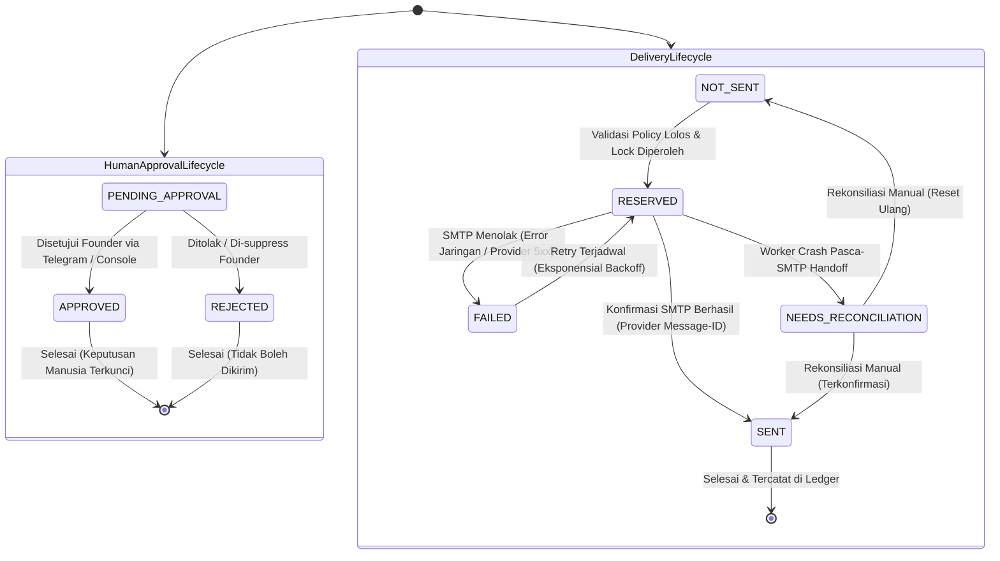

# JAGAT G7 — Phase 1.1 Integration Architecture (Revised)
**Document Version:** 1.1.0 (Architecture Review Revision)  
**Status:** DRAFT PROPOSAL — AWAITING FOUNDER APPROVAL  
**Scope:** Core Engine (`c:\JAGAT`) & Operations Console (`c:\apps\jagat-phase-1-console`) Integration  

---

## 1. Architectural Topology & Component Boundaries

Konsol Operasional Phase 1 berfungsi sebagai **Dedicated Operations & Observability Plane** (Port 5005), sedangkan JAGAT Core bertindak sebagai **Authoritative Execution & Storage Plane** (Port 5000).

```
┌────────────────────────────────────────────────────────────────────────┐
│                   JAGAT Operations Console (Port 5005)                 │
│      • Human Approval Cockpit (Founder Decision Interface)            │
│      • Delivery & Idempotency Monitor                                 │
│      • Inbound Security Sandbox & Intent Evaluation                   │
│      • Model Cost & Metric Provenance Dashboard                       │
└───────────────────────────────────┬────────────────────────────────────┘
                                    │ HTTP REST / Coordinated IPC
                                    ▼
┌────────────────────────────────────────────────────────────────────────┐
│                   JAGAT Core API / Control Plane (Port 5000)           │
│      • State Authorization & Security Policy Enforcement               │
│      • Coordinated Serialized Queue Writer (Mutex + Atomic Flush)      │
│      • Event-Driven Telegram Gatekeeper (Notification Ledger)          │
└───────────┬───────────────────────┬──────────────────────┬─────────────┘
            │                       │                      │
            ▼                       ▼                      ▼
┌───────────────────────┐ ┌───────────────────┐ ┌────────────────────────┐
│     Colony Swarm      │ │    Task Engine    │ │   Model Cost Router    │
│ (Scout, Analyst,      │ │ (C6 Scheduler,    │ │ (Ollama Llama 3.2 1B,  │
│  Closer Agent)        │ │  Redis Distributed│ │  Gemini 3.8 Flash,     │
│                       │ │  Token Locks)     │ │  Gemini 4 Argon)       │
└───────────┬───────────┘ └─────────┬─────────┘ └──────────┬─────────────┘
            │                       │                      │
            └───────────────────────┼──────────────────────┘
                                    │
                                    ▼
┌────────────────────────────────────────────────────────────────────────┐
│                 Authoritative Data & External Services                 │
│  • CSV/JSONL: PROSPECT_TRACKER.csv, outreach-send-ledger.jsonl         │
│  • Coordinated Approval Ledger: approval-ledger.jsonl                  │
│  • Telegram Notification Ledger: telegram-events.jsonl                 │
│  • Redis (6379): Lock Tokens & Active Worker State                     │
│  • Qdrant (6333): 768-Dim Vector Knowledge ('jagat_indonesia_knowledge')│
│  • Gmail: Outbound SMTP (Port 465 SSL) & Inbound IMAP (Port 993 TLS)    │
│  • Telegram: Bot Interactive Inline Callback Gate                      │
└────────────────────────────────────────────────────────────────────────┘
```

---

## 2. Pemisahan Tegas Dua State Independen: Approval vs Delivery

Sesuai koreksi Arsitektur Review #1, **Approval State** dan **Delivery State** dipisahkan secara permanen menjadi dua entitas siklus hidup yang berbeda:



* **Aturan Mutlak:** 
  1. Pengiriman SMTP yang berhasil **TIDAK BOLEH** mengubah `approval_status` menjadi `APPROVED` secara otomatis.
  2. Hanya tindakan manusia (Founder via Console / Telegram Callback) yang berhak mengubah `approval_status`.
  3. `delivery_status` hanya berubah ke `SENT` setelah provider SMTP (Gmail / Staging) mengembalikan tanda terima Message-ID yang valid.
  4. Pengiriman simulator/test tanpa persetujuan manusia tetap mencatat approval sebagai `PENDING` (atau `SIMULATED_TEST`), tidak boleh memalsukan persetujuan founder.

---

## 3. Coordinated Serialized Writer & Atomic Append

Sesuai koreksi Arsitektur Review #2, penulisan ke seluruh file ledger (`outreach-send-ledger.jsonl`, `approval-ledger.jsonl`, `telegram-events.jsonl`, `PROSPECT_TRACKER.csv`) tidak lagi mengandalkan `fs.appendFile` bebas.

* **Mekanisme Coordinated Writer:**
  1. **In-Memory Sequential Mutex Queue:** Setiap operasi penulisan masuk ke antrean serial asinkron berbasis Promise Queue untuk mencegah *race condition* antar worker.
  2. **Unique Event ID:** Setiap event wajib memiliki identitas global:
     `evt_${Date.now()}_${crypto.randomBytes(4).toString('hex')}`
  3. **Atomic Flush & Validation:** Data diformat menjadi satu baris JSON valid dengan karakter newline `\n` terisolasi sebelum di-flush ke disk.
  4. **Pre-Write Backup Strategy:** Skrip otomatis membuat snapshot file ledger sebelum batch update dilakukan (`.backup-timestamp`).

---

## 4. Event-Driven Telegram Gatekeeper (Anti-Spam Deduplication)

Sesuai koreksi Arsitektur Review #3, pengiriman notifikasi Telegram statis setiap 3 jam dinonaktifkan dan diganti dengan **Event-Driven Notification Gate**:

1. **Trigger Tunggal:** Notifikasi hanya dibuat saat ada lead baru yang berpindah ke status `PENDING_APPROVAL`.
2. **Notification Ledger (`telegram-events.jsonl`):**
   Mencatat `notif_id`, `lead_id`, `campaign_id`, `message_hash`, `sent_at`, dan `status: DELIVERED | ANSWERED`.
3. **Deduplikasi Mutlak:** Sebelum mengirim pesan ke Telegram, periksa apakah `{lead_id}:{campaign_id}` sudah tercatat di ledger. Jika sudah ada, transmisi **dibatalkan**.
4. **Interactive Callbacks:** Pesan dilengkapi tombol inline:
   - `[✅ Approve & Send]` $\rightarrow$ callback payload: `appr:{approval_id}:{lead_id}`
   - `[❌ Reject & Suppress]` $\rightarrow$ callback payload: `rej:{approval_id}:{lead_id}`
   - `[✏️ Edit Body]` $\rightarrow$ membuka sesi edit di Console.
5. **Callback Signature Verification:** Setiap callback memverifikasi otorisasi `user_id` pengirim terhadap ID Telegram Founder yang terdaftar di `.env`.

---

## 5. 5-Way Prospect Classification Policy

Sesuai koreksi Arsitektur Review #4, balasan email masuk diklasifikasikan ke dalam 5 status tegas:

1. **`UNSUBSCRIBE_OPT_OUT`:**
   - *Kriteria:* Permintaan eksplisit untuk berhenti (*"unsubscribe"*, *"stop email"*, *"hapus kontak saya"*).
   - *Aksi:* Status lead $\rightarrow$ `UNSUBSCRIBED`, alamat email masuk ke `suppressedEmails: Set` permanen.
2. **`NOT_NOW_OBJECTION`:**
   - *Kriteria:* Keberatan waktu/anggaran (*"belum butuh sekarang"*, *"hubungi bulan depan"*, *"anggaran habis"*).
   - *Aksi:* Status lead $\rightarrow$ `OBJECTION_HOLD`. **TIDAK dimasukkan ke blacklist supresi**. Jadwalkan re-evaluasi 30 hari.
3. **`NEGATIVE_GENERAL`:**
   - *Kriteria:* Penolakan umum tanpa permintaan opt-out (*"tidak relevan"*, *"kami sudah punya vendor"*).
   - *Aksi:* Status lead $\rightarrow$ `CLOSED_LOST`. **TIDAK dimasukkan ke blacklist supresi**.
4. **`POSITIVE_INTEREST`:**
   - *Kriteria:* Minat demonstrasi / tanya harga (*"boleh kirim demo"*, *"berapa biayanya"*, *"jadwalkan call"*).
   - *Aksi:* Status lead $\rightarrow$ `POSITIVE` (Confidence $\ge 0.88$). Kirim link Calendly.
5. **`NEEDS_HUMAN_REVIEW`:**
   - *Kriteria:* Teks ambigu, pertanyaan kompleks, atau terdeteksi serangan prompt injection.
   - *Aksi:* Status lead $\rightarrow$ `NEEDS_HUMAN_REVIEW`. Eskalasi ke founder.

---

## 6. Metric Provenance Standard

Setiap metrik di dashboard wajib menyertakan atribut `provenance`:
* `ACTUAL`: Dihitung langsung dari baris CSV / JSONL Core.
* `ESTIMATED`: Dihitung dari formula token multiplier pemakaian model riil.
* `SIMULATED`: Dihasilkan oleh simulasi test sandbox di memori.
* `UNAVAILABLE`: Layanan terkait (misal Redis/Ollama) sedang offline.
